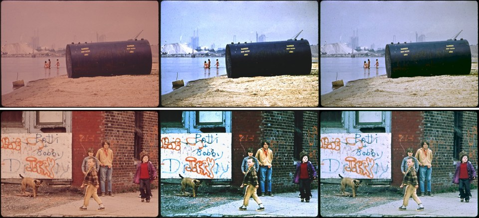
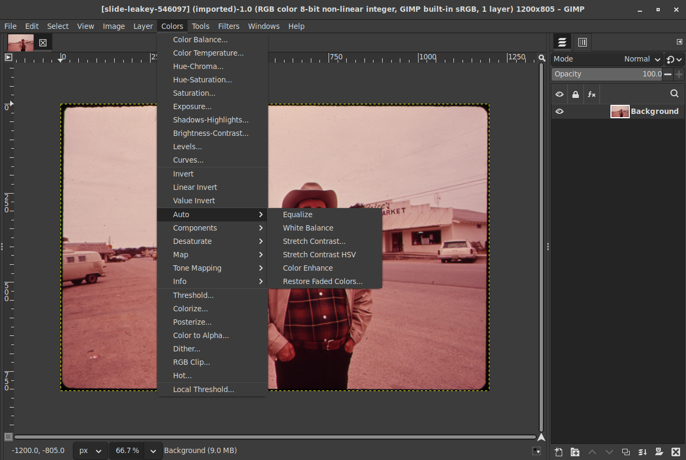
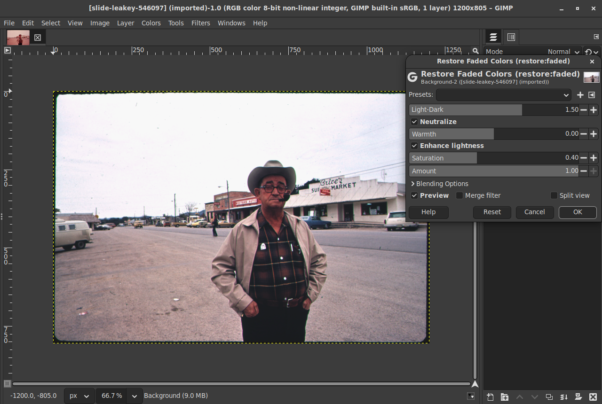

# gegl-photo-restore

**Status: working, before the GUI test.** All three stages of the method
are in; the numerical, headless GIMP and reference tests pass; the dialog
has not been looked at on screen yet (PLAN.md).

Restores the colours of scanned faded slides and prints automatically,
as a non-destructive filter for GIMP 3.2 (a GEGL operation), after Geoff
Daniell's [PhotoRestore](https://github.com/stongey/PhotoRestore) for
GIMP 2. Daniell's model: as the dyes fade, each channel of the scan
becomes a power of the original (`C' = C^alpha`, with a different
`alpha` for each dye), so a restoration is a power and a scale per
channel, estimated from the spread of colours in the image itself.

Left: two slides of the EPA DOCUMERICA series, US National Archives,
public domain: "Chemical plants on shore are considered prime source of
pollution", Marc St. Gil, NARA 546220
([Commons](https://commons.wikimedia.org/wiki/File:CHEMICAL_PLANTS_ON_SHORE_ARE_CONSIDERED_PRIME_SOURCE_OF_POLLUTION_-_NARA_-_546220.jpg)),
and "Children on a street in East Brooklyn", Jim Pickerell, NARA 546873
([Commons](https://commons.wikimedia.org/wiki/File:CHILDREN_ON_A_STREET_IN_EAST_BROOKLYN_-_NARA_-_546873.jpg)).
Middle: `restore:faded` with its defaults. Right: Daniell's own program
on the same files.

## Use

**Colors > Auto > Restore Faded Colors**, below White Balance and Color
Enhance (seen in GIMP 3.2.8). With the defaults it is one click; the
settings:

| Setting | Default | What |
|---|---|---|
| Light-Dark | 1.5 | the shape of the ideal spread of colours: larger is darker (Daniell's Light-Dark; his default is 1) |
| Neutralize | on | stage 2, the grey balance |
| Warmth | 0 | moves the neutral point towards yellow (1) or blue (-1), by up to half the way from the D65 to the D50 white; 0 is Daniell's own, slightly warm white |
| Enhance lightness | on | stage 3: the darkest and lightest 2.5% moved half way to L\* 10 and 95 |
| Saturation | 0.4 | stage 3: the mean saturation (CIE L\*u\*v\*) raised to this if below, at most 1.5 times; 0 is off |
| Amount | 1 | how much of the correction: everything blended towards no change |

The estimate is made once from the whole image, so the result is the
same whatever tiles or region GIMP renders, and the same on every run.
Integer images are clipped to 0 to 1, as Daniell's (8 bit); values that
were above 1 in a float image stay above 1. Alpha and pixels that are not
finite pass through.

## The method

Daniell's newest method (pyrestore4.py, 2019), in three stages, on a
small copy of the image (box averaged, at most about 100 pixels on the
long side). Its colours are binned 16 levels per channel (4096 bins) and
each bin with pixels gives one colour, so that a large area of one
colour counts no more than a small one.

1. **Dye loss**: for each channel a power and a scale that spread the
   colours, sorted by luminance, along the ideal ramp `(i/n)^gamma`
   (least squares; the best scale for a given power is closed form, the
   power is found by a grid and a golden section search).
2. **Grey balance**: a second power and scale per channel so that the
   mean L\* is 50 and u\*, v\* are neutral on average and do not drift
   with lightness (Daniell's measure, the first three Legendre moments),
   found by Levenberg-Marquardt from no change. The neutral point is
   Daniell's empirical white (u' 0.2005, v' 0.4665 under D65).
3. **Enhancement**: a two piece linear map of L\* around 50, and a
   scale of u\*, v\*.

Stages 1 and 2 combine into one power and scale per channel; stage 3 is
done per pixel in L\*u\*v\* (GEGL's XYZ, adapted to D65 with Bradford's
matrix, so that Daniell's white point applies).

### Deviations from pyrestore4.py, with their numbers

Decided by David: start from pyrestore4.py's numbers and deviate where
the tests measure a better result. The measure, unless said otherwise:
the mean Delta E 1976 between the restored and the original photo, over
10 CC0 photos faded synthetically with 4 fadings each (tests/photos.sh;
lower is better). Final settings: 15.22.

| Deviation | Measured |
|---|---|
| Stage 2 held towards no change: a residual of weight 1 per log of each of its six numbers. Daniell's simplex stops early (its relative stop test); the full minimum finds strong corrections that flatten photographs | weight 0: 18.14; 0.5: 15.56; **1: 15.22**; 2: 15.14. The weight also decides how well a fading is undone on the generated grid: 0.5: 5.65, **1: 6.69**, 2: 7.10, pyrestore4.py 7.04 (below). 1 is the largest weight that stays under pyrestore4.py there. Daniell's own simplex (with Light-Dark 1.5, Saturation 0, as weights 3 to 30 at 15.14 to 16.08): 15.95 |
| The copy at most about 100 pixels on the long side, not 1/8 of the scan (which made the result depend on the scan's resolution) | 512 pixels: 17.76; **100: 15.22**. At an earlier setting: 64: 15.22, 100: 15.39, 150: 15.72 |
| Light-Dark default 1.5, not 1 | 1: 16.71; 1.25: 15.69; **1.5: 15.23**; 1.75: 14.94; 2: 15.08 (the last four at an earlier stage 2 weight of 5). 1.75 is a little better on these photos but darker on the faded slides; see PLAN.md |
| Saturation target 0.4, not 0.6, and the factor at most 1.5 (as Daniell's Restore2) | at Light-Dark 1: 0.6: 17.44, **0.4: 16.71**; at 1.5 (stage 2 weight 5): 0.6: 16.21, 0.4: 15.27, 0: 15.23. The limit changes nothing on the photos; without it a gray ramp came out green-yellow (mean a\* -6.6, b\* 3.6) in an earlier build, with it 1.1, -0.5 |
| The colours are bin means of a box averaged copy, not the first pixel seen per bin of a nearest neighbour copy (open question 3) | first pixel 15.35, **means 15.39**: no measurable difference; means kept, as less dependent on noise and on which pixel comes first |
| L\*u\*v\* from GEGL's XYZ adapted to D65, not Daniell's sRGB formulas (open question 4) | the white point re-derived around D50 instead: 15.17 against **15.23**: no measurable difference; D65 kept, so Daniell's white point numbers apply as they are, and images in other RGB spaces are converted properly |
| Everything in floating point: pyrestore4.py truncates to 8 bits inside its fits, and its stage 3 rounds linear light to 101 levels (`xpand`) | not measured separately |
| The lightness percentiles exact, not from an integer histogram; stage 1's search one dimensional and closed form, not a simplex | the same stage 1 numbers within about 0.01 (docs/research.md) |

### Measured

**Real photos, faded synthetically** (tests/photos.sh; 10 CC0 photos of
Wikimedia Commons scaled to 1200 pixels, each faded 4 ways with
Daniell's model: his Table 1 cyan loss, a yellow loss, an even fading, a
magenta loss). Delta E 1976 to the original photo: mean, mean of the
95th percentiles, the worst photo's mean; and "to itself": to the same
method's result on the unfaded photo (how well the fading is undone,
whatever the method makes of the photo).

| Method | Mean | 95th | Worst photo | To itself |
|---|---|---|---|---|
| the faded photos | 23.17 | 29.5 | | |
| **restore:faded** | **15.22** | 24.5 | 24.44 | **6.05** |
| pyrestore4.py | 20.02 | 28.2 | 33.35 | 8.90 |
| GIMP White Balance | 19.04 | 28.4 | 30.38 | 15.41 |
| per channel stretch | 19.30 | 26.6 | 31.17 | 18.69 |
| gray world | 16.22 | **23.2** | **23.19** | 12.74 |

`restore:faded` is better than every baseline and than pyrestore4.py on
the mean; gray world is a little better on the 95th percentile and on
the worst photo. Daniell's method assumes a photograph whose colours
spread evenly; on photos that do not (a red market stall, a dark
stylised portrait) it changes the unfaded photo too, by up to a mean of
24 here (pyrestore4.py up to 33). "GIMP White Balance" is GIMP 3.2.6's
algorithm re-implemented in tests/photos.py (per channel Levels on a
linear histogram, 0.6% cut at each end), not GIMP itself.

**Generated scene, a grid of 54 fadings** (tests/check.c, every channel's
`alpha` 0.45, 0.7 or 0.95, maxima 1 or 0.8 to 1): Delta E of the
restoration of a faded copy to the restoration of the unfaded scene.
`restore:faded`: mean 6.69, worst 11.5; pyrestore4.py: mean 7.04, worst
18.1, and it stops with an error on 4 of the 54 (a negative power of
zero: its fit gave a negative exponent). On the three named fadings of
tests/check.c, pyrestore4.py is closer (2.9 to 5.5 against 6.4 to 9.1).
(tests/reference.sh, from 8 bit PNGs.)

**Real faded slides** (tests/photos.sh --slides; six DOCUMERICA slides,
public domain): no ground truth; the mean a\*, b\* of the near neutral
pixels goes from up to 8.1, 2.3 in the scans to within 6.4 of neutral
(pyrestore4.py: within 6.4 too), and the pictures were looked at
(above).

**Speed** (tests/bench.sh, 6000 x 4000 pixels, this machine with 24
threads): 0.29 s in float, 0.42 s in 8 bit (gegl:gaussian-blur 40 takes
0.38 s); 2.4 s on one thread.

## Build and test

Built against the GEGL of the native GIMP 3 (on Debian and Ubuntu `sudo
apt install gimp libgimp-3.0-dev meson ninja-build`) with
[gimp-devtools](../gimp-devtools) next to this folder; nothing is
installed and the tests touch none of your own GIMP folders (they run
with a throwaway home in tests/output and check your folders before and
after).

    tests/check.sh            # build, 23 numerical checks, also under ASan and UBSan
    tests/check.sh quick      # the same without the sanitizers
    tests/gimp-check.sh       # the filter in headless GIMP 3.2 against plain GEGL
    tests/reference.sh        # Daniell's pyrestore4.py on the same images (needs NumPy, Pillow)
    tests/images/fetch.py     # the test photos from Wikimedia Commons (not in git)
    tests/photos.sh           # real photos faded synthetically, against pyrestore4.py and baselines
    tests/photos.sh --slides  # the faded DOCUMERICA slides
    tests/bench.sh            # the timing on 24 megapixels
    tests/gui/shots.sh        # the dialog on screen (Broadway, headless Chrome)

To try it in GIMP by hand, build with `meson setup build
-Dmoduledir=$HOME/.local/share/gegl-0.4/plug-ins` and `ninja -C build
install`. GIMP loads GEGL operations at start.

## Files

- operations/faded.c: the operation
- tests/check.c, tests/check.sh: numerical checks on generated images
- tests/gimp-check.py, tests/gimp-check.sh: in GIMP
- tests/reference: Daniell's pyrestore4.py ported to Python 3 (his
  code, GPL-3.0-or-later, the changes listed in its header) and a
  comparison script
- tests/images: the fetch script and the list of test photos (authors,
  licences, SHA-256)
- tests/photos.py, tests/slides.py, tests/photos.sh: real photos and
  slides
- tests/bench.c, tests/bench.sh: timing
- tests/gui: the GUI test
- docs/research.md: PhotoRestore's code, options and licence, the physics
  of dye fading, other methods and tools, sources
- PLAN.md: the design, the open questions and the defaults chosen

## Licence

GPL-3.0-or-later (COPYING), as PhotoRestore. The method is Geoff
Daniell's ("Restoration of Faded Slides", 2008, and "Restoration of
Faded Slides II", 2016, in the PhotoRestore repository). The test photos
are CC0 and public domain (tests/images/README.md).
