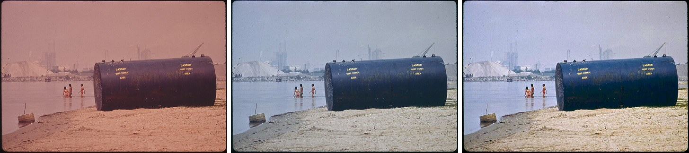

# gegl-photo-restore

**Status: skeleton.** A design (PLAN.md) and a first, partial filter for
review; not for use yet.

Restores the colours of scanned faded slides and prints automatically,
as a non-destructive filter for GIMP 3.2 (a GEGL operation), after Geoff
Daniell's [PhotoRestore](https://github.com/stongey/PhotoRestore) for
GIMP 2. Daniell's model: as the dyes fade, each channel of the scan
becomes a power of the original (`C' = C^alpha`, with a different
`alpha` for each dye), so a restoration is a power and a scale per
channel, estimated from the spread of colours in the image itself.

Left: "Chemical plants on shore are considered prime source of
pollution", Marc St. Gil, June 1972, EPA DOCUMERICA, US National
Archives 546220, public domain
([Commons](https://commons.wikimedia.org/wiki/File:CHEMICAL_PLANTS_ON_SHORE_ARE_CONSIDERED_PRIME_SOURCE_OF_POLLUTION_-_NARA_-_546220.jpg)).
Middle: this skeleton. Right: Daniell's own program on the same file.

## What the skeleton does

`restore:faded`, in **Colors > Auto > Restore Faded Colors**, does only
the **first of the three stages** of Daniell's newest method
(pyrestore4.py): the per channel power law fitted to an ideal spread of
colours, with his **Light-Dark** setting. The grey balance and the
lightness and saturation stages are planned (PLAN.md). The estimate is
made once from the whole image, so the result is the same whatever
tiles or region GIMP renders.

## Build and test

Built against the GEGL of the native GIMP 3 (on Debian and Ubuntu `sudo
apt install gimp libgimp-3.0-dev meson ninja-build`) with
[gimp-devtools](../gimp-devtools) next to this folder; nothing is
installed and the tests touch none of your own GIMP folders (they run
with a throwaway home in tests/output and check your folders before and
after).

    tests/check.sh          # build, 13 numerical checks, also under ASan and UBSan
    tests/check.sh quick    # the same without the sanitizers
    tests/gimp-check.sh     # the filter in headless GIMP 3.2 against plain GEGL
    tests/reference.sh      # Daniell's pyrestore4.py on the same images (needs NumPy, Pillow)

To try it in GIMP by hand, build with `meson setup build
-Dmoduledir=$HOME/.local/share/gegl-0.4/plug-ins` and `ninja -C build
install`. GIMP loads GEGL operations at
start.

## Files

- operations/faded.c: the operation
- tests/check.c, tests/check.sh: numerical checks on generated images
- tests/gimp-check.py, tests/gimp-check.sh: in GIMP
- tests/reference: Daniell's pyrestore4.py ported to Python 3 (his
  code, GPL-3.0-or-later, the changes listed in its header) and a
  comparison script
- docs/research.md: PhotoRestore's code, options and licence, the physics
  of dye fading, other methods and tools, sources
- PLAN.md: the design and the open questions

## Licence

GPL-3.0-or-later (COPYING), as PhotoRestore. The method is Geoff
Daniell's ("Restoration of Faded Slides", 2008, and "Restoration of
Faded Slides II", 2016, in the PhotoRestore repository).
